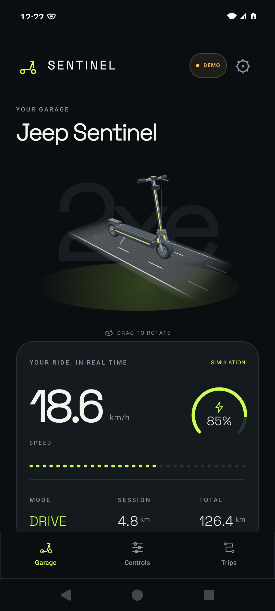
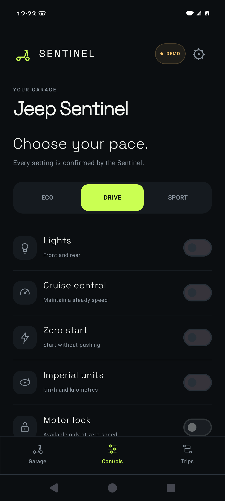
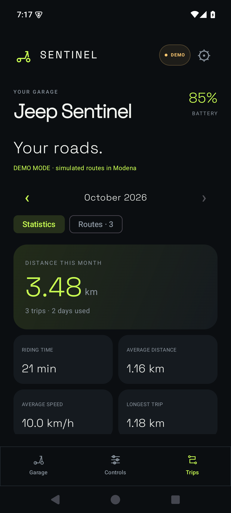
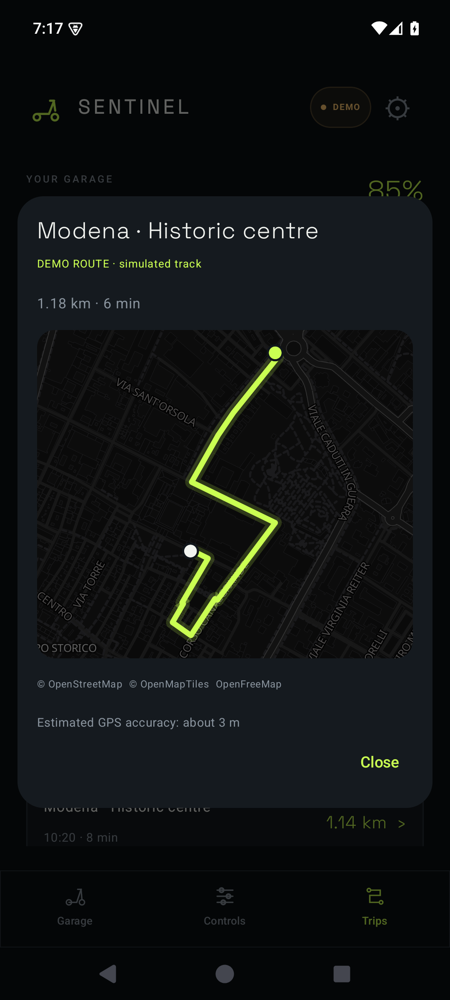

# Sentinel

An independent Android app for your electric scooter. Connect over Bluetooth,
check live data, control the lights and keep a local history of your rides.

Built with Kotlin and Jetpack Compose. Android 8.0+ and OpenGL ES 3.0 required.

<p>
  
  
  
  
</p>

## Features

- Bluetooth connection to the selected scooter, including a connection attempt
  at startup and when switching vehicles in Settings.
- Live speed, battery and distance, where provided by the vehicle.
- Light controls with state confirmation from the scooter.
- Quick riding mode selection on the Home screen, plus switches and radio
  selectors for vehicle settings.
- Local 3D model with horizontal rotation, animated wheels and road, and a
  headlight beam that follows the reported light state.
- Multiple saved scooters.
- Automatic trip recording using the phone's GPS while connected to a scooter.
- Daily trip history, monthly distance charts, riding time and other statistics.
- Scooter labels on new trips and a vehicle filter for history and statistics.
- Route maps using MapLibre and OpenFreeMap, based on OpenStreetMap data.
- Local trip backups that can be restored without Google, plus GPX route export.
- YouFs scooter sharing and import, separate from trip backups.
- Optional Google Drive sync for completed trips, scooters and automatic
  recording settings.
- Debug information and experimental controls hidden behind one Settings toggle.

## Supported scooters

Support is limited to the two profiles below. A shared brand name, controller
label or Bluetooth service does not guarantee compatibility with another model.

| Profile | Identified transport | Confirmed scope |
| --- | --- | --- |
| Jeep 2xe Sentinel | Kcq, FFF0 service with FFF6/FFF7 characteristics | Identified telemetry/control protocol; light control verified during development |
| YouFs-A scooter, product `ivybh960` | Tuya FD50, new security profile | Account/device retrieval and authenticated communication; headlight control verified on the owner's vehicle |

Other controls are implemented from the identified protocol or device schema,
but are not a claim that every physical feature has been tested. Available data
and commands depend on the exact hardware and firmware. Energy recovery, optional
battery locking, disconnection alarms and advanced RGB/scene/music lighting are
not confirmed for the tested YouFs scooter and remain experimental.

**Other Jeep, YouFs and Tuya models are not assured to work.**

## Getting started

1. Download the APK from the release page and install it.
2. Open **Settings → Add a scooter**.
3. For Jeep Sentinel, search for the Bluetooth device. For YouFs-A, sign in
   with your existing YouFs-A account or import a scooter shared by another user.
4. Turn on the scooter and close other apps connected to it.
5. Allow Bluetooth access and wait for live vehicle data.

The last selected scooter is remembered. Google is optional: normal Bluetooth
use, trip history and local backups work without a Google account.

YouFs onboarding contacts the original OEM account gateway. Its API is reverse
engineered and can change. The app does not save your YouFs password; its saved
session and vehicle credentials are encrypted locally using Android Keystore.
**Disconnect YouFs account** clears the saved account session on this phone
without removing configured scooters or trips.

## Trips, maps and backups

Grant **precise location** to enable automatic recording. A trip starts after
about 8 seconds of movement above 5 km/h and at least 15 metres of displacement.
It ends after about 2 minutes stopped. The foreground GPS service shows a
notification and can continue recording with the screen off.

GPS accuracy depends on the phone and surroundings. Weak, old or inconsistent
fixes are filtered; routes are not snapped to roads. Online map requests go to
the map provider. Recorded GPS tracks stay local unless exported or synced.

From **Settings → Trip backup**:

- **Save backup** exports completed trips to a `.sentinel` file, including routes
  and recorded scooter labels. Account sessions and vehicle keys are excluded.
- **Restore backup** validates the whole file and adds missing trips without
  duplicating or overwriting existing trips. Explicitly restoring a backup can
  recover previously deleted trips. Finish an active trip before restoring.
- **Export GPX routes** creates a GPX file for other mapping tools. GPX is not
  a replacement for a Sentinel backup and cannot be imported as trip history.

Backups, GPX files and shared scooter JSON files are readable by their recipients.
A shared scooter JSON contains the keys needed to control that scooter; share
it only with people you authorize. It does not contain your YouFs account or trips.

## Optional Google sync

Google sync uses the app's private Drive folder. It merges completed trips,
configured scooters, Bluetooth credentials and automatic recording preferences
between phones using the same Google account. Active trips are uploaded after
they finish. Deleted records are synchronized too.

## Build

Requirements: **JDK 21**, **Android SDK Platform 36** and Android build tools.
The first build needs Internet access to download Gradle dependencies.

Open this folder in Android Studio, or configure `ANDROID_HOME`/`local.properties`
and run:

```sh
./gradlew :app:assembleDebug :app:testDebugUnitTest :app:lintDebug
```

On Windows, use `gradlew.bat`; `compila.ps1` also detects common JDK/SDK locations.
The APK is generated at `app/build/outputs/apk/debug/app-debug.apk`.
The Android application ID remains `it.bilar.sentinel` to preserve compatibility
with existing installations. The project and app name are **Sentinel**.

The commands above build a development APK. For a signed release, copy
`signing.properties.example` to the gitignored `signing.properties`, or set
`SENTINEL_SIGNING_PROPERTIES` to a credentials file outside the repository, then
run `./gradlew :app:assembleRelease :app:testReleaseUnitTest :app:lintRelease`.
On Windows, `./compila.ps1 -Release -SigningProperties C:/private/signing.properties`
also builds and checks the signed APK. The output is
`app/build/outputs/apk/release/app-release.apk`.

Keep the private keystore and its passwords backed up outside the repository.
Updates require a compatible signing certificate. A release signed with a new
key cannot directly replace an existing debug installation; save trip history
and any needed scooter exports before uninstalling. Register the release
certificate's SHA-1 with the Android OAuth client for `it.bilar.sentinel` in
Google Cloud to enable Google authorization in the release build.

## Assets and third-party software

The original source code and generated scooter model are released under
[The Unlicense](LICENSE). Third-party code, fonts, maps and libraries retain
their own licenses; see [third-party notices](licenses/THIRD_PARTY_NOTICES.md).

The model can be regenerated with `python tools/create_scooter.py`, using only
the Python standard library. The YouFs protocol engine runs locally in a private
WebView with network and file access disabled; its JavaScript dependencies are
bundled with the app.

Sentinel is an independent project and is not affiliated with Jeep, YouFs,
Tuya or their manufacturers. The motor lock is a vehicle setting, not a substitute
for a physical lock. Command results depend on the vehicle's actual confirmation.
